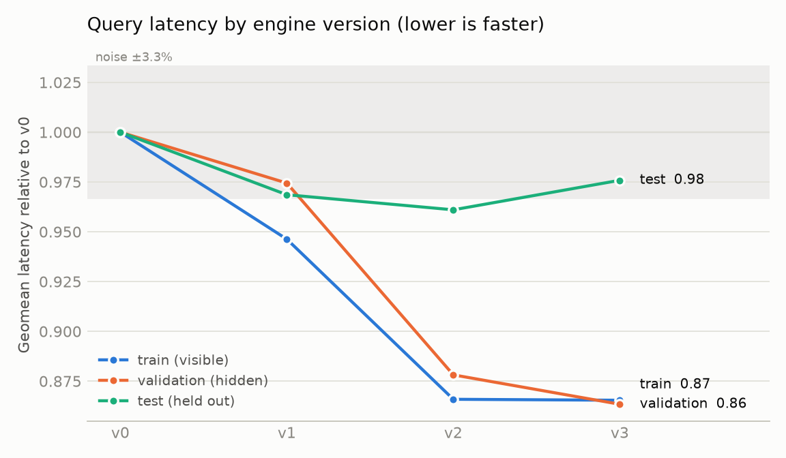

# db_evolve

A research framework in which AI agents evolve an existing database engine into faster versions
of itself for a given workload, and a harness measures whether the gains generalise.

The first target is **DuckDB** on **TPC-H**. Agents (Claude Opus 5.5 through Claude Code) change
DuckDB's C++ source; every change is built, checked for correctness, reviewed by an independent
agent, and timed against the current best. Changes that clear a pre-set bar accumulate into
releases v1, v2, v3, which are then compared with the original engine (v0) on query templates the
agents never saw.

## The question

Can an agent loop make a mature engine faster for a workload **without** overfitting to it:
without hardcoding answers, recognising benchmark queries, or adding fast paths that help nothing
else?

The evaluation is built around that question:

- Queries are generated from **templates** with seeded parameters, several bindings per template.
- **Whole templates** are split: 14 train, 3 validation, 5 test (64 / 14 / 22 % of TPC-H's 22).
- Agents see only the train queries. Validation templates gate acceptance (agents learn pass or
  fail, nothing more). Test templates are run only for the final report.
- A change must also give correct answers on new parameter values, on a second dataset, and on
  generic SQL over an unrelated schema.

A gain that shows on train but not on test is overfitting, and the report puts the two side by
side.

## How it works

```
profile current best ─► planner ─► implementer ─► gates ─► reviewer ─► A/B timing ─► accept / retire
        ▲                (issues)   (edits C++)   (build,   (fresh      (interleaved,      │
        │                                         correct-  context)    bar fixed          │
        └──────────── ledger, issue backlog, planner memory ◄─────────── in advance) ◄─────┘
```

- **Planner** reads the profile and the record of past experiments, files issues, picks one.
- **Implementer** changes the engine in a git worktree and can build, time and profile it.
- **Gates** are mechanical and owned by the harness: path policy, a static audit for workload
  identifiers, the build, result equality with the original engine, a generic SQL suite.
- **Reviewer** reads only the diff, looking for benchmark-specific shortcuts and missing guards.
- **Timing** interleaves candidate and incumbent (`ABBA`) with a clock outside the engine process.
  The bar: at least one train template faster by 5 % and beyond 1.5x its own measured noise, no
  template (train or validation) slower beyond the same kind of threshold, and the train geomean
  not slower. Borderline results are re-timed with four more passes. (The pilot used a
  geomean-only bar; see the pilot results below for why it changed.)
- Every experiment, accepted or retired, is written to a ledger with its reason.

[docs/architecture.md](docs/architecture.md) has the full design,
[docs/related-work.md](docs/related-work.md) what was taken from the papers in `docs/` and from
Intent Lab's ClickBench post, and [plan.md](plan.md) the roadmap.

## Quick start

Requirements: Linux x86-64, git, curl, about 6 GB of disk, and the `claude` CLI logged in (only
for real agent runs). No root access is needed.

```bash
# 1. Compiler, CMake, Ninja, ccache and Python into .toolchain/ (about 2 GB, no sudo)
./scripts/bootstrap_toolchain.sh

# 2. Clone and build DuckDB v1.5.6, generate TPC-H data, compute reference results
bin/dbe setup

# 3. Time the unmodified engine on every split, then measure the noise floor
bin/dbe baseline
bin/dbe calibrate

# 4. Dry run: the whole loop with a scripted agent, no model calls
bin/dbe evolve --run dry --backend mock --generations 1 --rounds 1

# 5. A real run with Opus 5.5 (start small; this spends model usage and takes hours)
bin/dbe evolve --run pilot --generations 1 --rounds 3

# 6. Evaluate every released version on train, validation and test
bin/dbe report --run pilot
```

`bin/dbe evolve --run <id>` resumes a run that was interrupted. `bin/dbe status` prints the
ledger. `bin/dbe check <commit>` runs the mechanical gates on any commit in `work/duckdb`.

## What a run produces

```
runs/<id>/
  state.json            current best commit, generation, round, releases, agent cost
  ledger.jsonl          one record per experiment: outcome, measured ratios, reasons
  issues.json           the planner's backlog
  memory.md             the planner's long-term notes
  profile.md            where time goes in the current best
  experiments/E0001/
    issue.json
    attempt-1/          prompts, agent output, diff.patch, gates.json, build.log
    timing.json         every timed run of incumbent and candidate
    decision.json       the bar applied
results/<id>/
  REPORT.md             geomean latency and speedup per version and split, per-template table
  report.json           the same, with every number
  latency_by_version.png, speedup_by_template.png
```

Accepted changes are commits on the `dbe/evolve` branch of `work/duckdb`; releases are the tags
`dbe/v0`, `dbe/v1`, ...

## Configuration

Everything is in [config/default.toml](config/default.toml): engine version and editable paths,
workload seed and split sizes, dataset scale factors, the benchmark protocol, the acceptance bar,
the agent model and per-role budgets, and the loop shape (generations x rounds). Pass another
file with `bin/dbe --config path.toml <command>`.

## Repository layout

| Path | Contents |
| --- | --- |
| `dbevolve/` | The framework (Python, standard library only; matplotlib for plots) |
| `dbevolve/workload/` | Workloads; `tpch.py` has the 22 templates and parameter rules |
| `dbevolve/prompts/` | Planner, implementer and reviewer instructions |
| `knowledge/` | Skills library given to agents: rules, DuckDB codebase map, profiling, playbook |
| `config/` | Configuration |
| `docs/` | Architecture, related-work notes, and the source papers |
| `tests/` | Unit tests: `.toolchain/env/bin/python -m pytest -q` |
| `work/`, `runs/`, `results/` | Generated: engine clone and builds, run state, reports |

## Status

### Results: SF 10 run (`runs/sf10`, Opus 5.5, $10.04)

Three generations of two rounds each, on TPC-H SF 10 with 8 threads. Five of six experiments
were accepted. Each version was timed by `bin/dbe report` against v0 and a v0 control:

| Version | train (visible) | validation (hidden) | test (held out) | Wrong results |
| --- | ---: | ---: | ---: | ---: |
| v0 | 267.3 ms | 245.4 ms | 167.4 ms | 0 |
| v1 | 1.057x | 1.026x | 1.032x | 0 |
| v2 | 1.155x | 1.139x | 1.041x | 0 |
| v3 | **1.156x** | **1.158x** | **1.025x** | 0 |

Report noise (v0 against its control): train ±1.4 %, validation ±3.3 %, test ±1.4 %.



| Exp. | Change (all in DuckDB's optimizer or join executor) | Gains on | Release |
| --- | --- | --- | --- |
| E0008 | Lower estimated selectivity for `contains`/`LIKE '%x%'` scan filters, so join build sides flip | q09 1.83x | v1 |
| E0009 | Bloom-filter pushdown for multi-key hash joins (one filter per equality key) | q09 | v1 |
| E0010 | Derive per-table filters from an OR of ANDs that sits under a top-level AND | q19 1.9x | v2 |
| E0011 | Remove the delim join for SEMI/ANTI subqueries when the subquery has no blocking operator | q04 1.4x, q22, val q21 1.45x | v2 |
| E0012 | Min-max and bloom join filters for RIGHT_SEMI/RIGHT_ANTI probes | q22, q18 | v3 |
| E0013 | Perfect hash join for dense integer keys | abandoned | - |

Reading the result:

- **Validation tracks train (1.158x and 1.156x).** The largest hidden gain, q21 at 1.49x, comes from
  E0011, a correlated EXISTS/NOT EXISTS rewrite that agents made for q04 and q22 without ever
  seeing q21. That is the generalisation the split was built to detect.
- **Test moved less (1.025x, just beyond its ±1.4 % noise) and nothing on it got slower.** The test
  templates mostly lack the shapes the changes target: q06 is a single scan, and q10 and q12 are
  plain joins. With five randomly chosen templates, the test set cannot tell a narrow but generic
  change from an overfitted one. [plan.md](plan.md) has the follow-up.
- The static audit, gates and reviewers raised nothing benchmark-specific; every reviewer approved
  on the first attempt. One train template, q16, measured 0.95x at v3, which is within its noise
  but should be rechecked.
- Total model spend for the pilot plus this run is about $18.25.

### Setup

Implemented and checked on this machine (16 cores, WSL2, DuckDB v1.5.6, TPC-H SF 1, 8 threads):

- Baseline v0: geomean latency 40 ms on train, 36 ms on validation, 24 ms on test; 0 wrong results
  over 88 query instances.
- The loop runs end to end with the mock backend: a no-op change passed every gate and was retired
  at the bar (+0.6 % against a required -2.7 %); a change mentioning a benchmark table was stopped
  by the static audit; a change under `test/` was stopped by the path policy.
- The Claude Code driver works with Opus 5.5: structured output parses, the agent can run
  `dbe-tool` and edit inside its worktree, and reads of the config, other shell commands and
  writes outside the worktree are denied.

### Pilot run (`runs/pilot`, Opus 5.5, $7.91 of a $19.50 cap)

Six experiments over three generations; **none was accepted, so v1 = v2 = v3 = v0.**

| Exp. | Idea | Outcome |
| --- | --- | --- |
| E0001-2 | Lower selectivity for `LIKE '%x%'` to change q09's join order | Abandoned: estimates moved, plan did not (premise misread the build side) |
| E0003 | Accept perfect-hash aggregation from cardinality estimates | Abandoned: q13 underestimated 5x, q17 overestimated 1000x; no threshold separates them |
| E0004 | Lazy-initialised perfect-hash aggregate table | Review rejected attempt 1 (ignored `perfect_ht_threshold=0`); fix approved; **retired at the bar: -0.3 %** |
| E0005 | Per-key bloom filters for multi-key joins | Abandoned: built, but the target table is the build side; 5 % slower |
| E0006 | Skip probes for adjacent duplicate group keys | Abandoned: aggregate CPU -10 %, no wall-time gain |

What worked: agents measured before committing and abandoned on evidence; the reviewer caught a
real semantic bug and approved the corrected version; no change tried to game the benchmark.

What did not: **the timing step.** Re-measured with 8 interleaved passes instead of 4, E0004 is
-2.4 % on train (q13 -21 %), -0.3 % on validation and **-3.2 % on the held-out test templates
(q15 -16 %)**. That is a general improvement the loop retired. At SF 1 queries take 20 to 120 ms
and single templates swing by 5 to 10 % between runs, and a geomean over 14 templates dilutes a
one-template gain below that noise. See "Phase 1 findings" in [plan.md](plan.md).

Measurement noise on this machine: identical binaries differ by 0.1 to 1.4 % on the train geomean
between A/A runs, and single templates by up to about 10 %.

## Limits worth knowing

- TPC-H is public and a model can recall its queries, so hiding templates limits steering rather
  than knowledge. The audit, the review and the held-out measurement carry the weight. A workload
  the model cannot have seen is planned.
- Agents are confined by Claude Code permissions, not a container.
- Correctness is differential testing against the original engine on sampled inputs, not proof.
- One experiment runs at a time; a full build of DuckDB takes about ten minutes on 8 cores,
  incremental builds much less.

The original project brief is kept in `README.MD.txt`.
