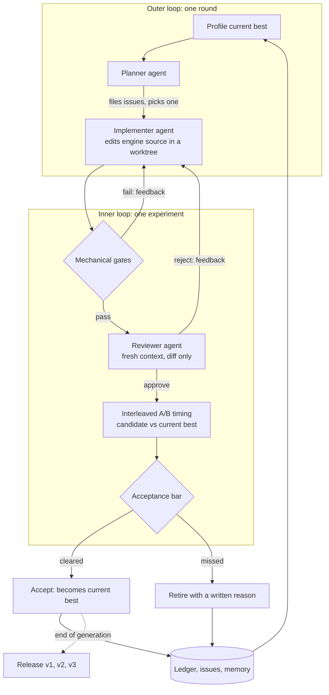

# Architecture

db_evolve takes an existing database engine and a workload, and produces a sequence of improved
versions of that engine (v1, v2, v3, ...) by letting agents change its source code under a
harness that decides, mechanically, what is kept.

The design borrows its outer/inner loop from VibeServe, its bar, shared record and adversarial
review from Intent Lab's ClickBench fleet, and its regression tracking and harness-owned tests
from Bespoke OLAP and JetStream. [related-work.md](related-work.md) says what came from where.

## Principles

1. **The harness owns the truth.** Agents never run the checks that judge them. Timing happens
   outside the engine process; tests, hidden queries and the accept/retire decision live in code
   agents cannot edit or read.
2. **The bar is set before anything is measured.** A change is accepted only if it clears
   thresholds written in the config, relative to a measured noise floor.
3. **Generalisation is measured, not assumed.** Whole query templates are held out. Agents
   optimise on train templates; validation templates gate acceptance; test templates are only run
   for the final report.
4. **Fresh context per role.** Planner, implementer and reviewer are separate agent runs that
   communicate through files. The reviewer never sees the implementer's reasoning.
5. **Everything leaves a record.** Each experiment stores its issue, diff, gate results, review,
   timings and a written reason, accepted or not. Later rounds read that record first.

## The loop



A **generation** is a fixed number of rounds. When it ends, the current best commit is tagged as
the next release. `bin/dbe report` then times every release on every split.

### Outer loop (`Loop.round`)

1. Check out the current best in the worktree slot and profile it: per-template times on the
   train split, and `EXPLAIN ANALYZE` plans for the slowest templates.
2. Run the **planner** with the profile, the ledger, the issue backlog and its own memory file. It
   returns new issues, the issue(s) to dispatch, and the new contents of its memory.
3. Run one experiment per dispatched issue.

The planner's state is structured and persistent (issues, ledger, memory), which is what lets it
tell a bad idea from a bad implementation of a good idea.

### Inner loop (`Loop.experiment`)

1. The **implementer** gets one issue and a worktree at the current best. It can edit engine
   source and call `bin/dbe-tool` to build, time the train queries, read plans and run SQL. It
   finishes with `ready` or `abandon`.
2. The harness commits the working tree and runs the **gates** in order, stopping at the first
   failure:

   | Gate | What it checks | Code |
   | --- | --- | --- |
   | Path policy | Only editable paths changed; diff under the size limit | `gates.path_policy` |
   | Static audit | Added lines contain no table names, column names or query literals | `gates.static_audit` |
   | Build | Release build of the engine | `Engine.build` |
   | Correctness | Results equal the baseline's on train instances, hidden extra bindings of train templates, and validation templates, on two datasets of different size | `gates.correctness` |
   | Generic SQL suite | 28 queries on an unrelated schema still match the baseline | `gates.smoke` |

3. The **reviewer**, in a fresh context, reads the diff against written criteria: benchmark-
   specific shortcuts, missing guards, cost moved out of sight, tampering with measurement.
4. A failed gate or a rejected review goes back to the implementer as feedback, up to
   `agents.max_fix_attempts` times. Feedback about hidden checks is a count only.
5. **Timing.** Candidate and current best run full passes in `ABBA` order on the train and
   validation instances. Every timed run's output is verified again. If the result is retired
   but borderline (some template moved at least half the way to a gain), four more passes run in
   `BAAB` order and the decision is made on all eight.
6. **Decision** (`bench.decide`, `bar.rule = "templates"`). Each template gets a threshold of
   `max(min_template_gain, noise_multiplier x its own A/A noise)` for gains, and the same with
   `max_template_regression` for slowdowns. Accept if all hold:
   - at least one train template is faster beyond its gain threshold;
   - no train or validation template is slower beyond its regression threshold (and `abs_slack_ms`);
   - the train geomean is not slower, and the validation geomean is within its tolerance.

   The pilot used `bar.rule = "geomean"` (train geomean at least 2 % faster and beyond the noise).
   It retired a change that made one template 21 % faster and slowed nothing, because a gain on
   one template in fourteen is diluted below run-to-run noise. The geomean rule is still available.
7. Accepted or retired, the experiment is appended to the ledger with its reason.

## Workload and splits

A workload is a set of query **templates** with seeded parameter generators
(`dbevolve/workload/`). TPC-H ships first: 22 templates with the spec's substitution rules.

| Split | Templates | Who sees the queries | Used for |
| --- | ---: | --- | --- |
| train | 14 | agents | profiling, the agent's own measurements, the gain requirement |
| held-out bindings | (the same 14) | harness only | correctness on new parameter values |
| validation | 3 | harness only | correctness, and the "no hidden slowdown" part of the bar |
| test | 5 | harness only, at report time | the reported generalisation result |

The split is a seeded shuffle of templates (`workload.seed`), so a template is in exactly one
split and every binding of it goes with it. Each template gets several parameter bindings.

Two datasets exist: `main` (SF 10, timing and correctness) and `shadow` (SF 1, correctness
only), so a candidate cannot depend on properties of one particular dataset. Paths carry the scale
factor (`main-sf10`), so data, databases, references and calibrations never mix. The pilot ran at
SF 1, where queries took 20 to 120 ms and single templates varied by up to 10 % between runs.

## Measurement

- **Process model.** Each binary loads the dataset's Parquet files into its own database file, so
  storage-layer changes are measured on storage the candidate wrote. Load time and file size are
  recorded.
- **Clock.** `session.Session` drives the engine CLI over pipes: it writes a statement followed
  by a `.print <sentinel>` command and stops the clock when the sentinel arrives. The measured
  time covers parse, plan, execute and result output. Nothing inside the candidate can alter it.
- **Statistic.** Per instance, the median of hot runs across passes; per template, the mean over
  its instances; per split, the geometric mean over templates.
- **Noise floor.** `bin/dbe calibrate` runs the baseline against itself (A/A) with the same
  protocol, several times. The largest deviation seen for each template, and for each split's
  geomean, becomes the noise term in that template's or split's threshold.
- **Reports carry their own control.** `bin/dbe report` times v0 twice, as itself and as a
  control, across alternating passes. The control's distance from 1.0 is printed as the report's
  noise and drawn as a band on the plot.
- **Serialisation.** Builds and benchmark passes take a machine-wide lock so they never overlap.

## Agents

Each agent call is `claude -p` (Claude Code headless) with the model from `agents.model`, a JSON
schema for its answer, and a budget cap. The agent's working directory is the worktree slot; the
context it needs is written to `.dbe/` inside it (knowledge files, train queries, profile, ledger,
issue, review material).

| Role | Can edit | Shell | Sees |
| --- | --- | --- | --- |
| Planner | no | `dbe-tool` only | profile, ledger, issues, memory, engine source |
| Implementer | engine worktree | `dbe-tool` only | one issue, feedback, profile, engine source |
| Reviewer | no | `dbe-tool` only | the diff, the issue, the author's summary, engine source |

`knowledge/` is the skills library: the rules every change must follow, a map of the engine's
codebase, a profiling guide and an optimization playbook. It is the place to add engine- or
hardware-specific know-how.

`agents.backend = "mock"` replaces the model with a scripted stand-in so the whole pipeline can be
exercised without model calls.

## What stops overfitting and cheating

| Risk | Defence |
| --- | --- |
| Hardcoding answers or parameter values | Hidden bindings; second dataset; every timed run verified |
| Recognising the benchmark's schema or literals | Static audit of added lines; reviewer rule 1 |
| Fast paths that only the train queries hit | Validation templates must not slow down; test templates reported |
| Breaking SQL the workload does not exercise | Generic SQL suite on an unrelated schema; reviewer rule 2 |
| Editing tests, the shell or timing | Path policy; clock outside the process |
| Accepting noise as progress | Per-template A/A noise; interleaved ABBA passes, re-timed when borderline; bar fixed in config |
| Agents steering by the hidden sets | Agents get pass/fail on validation, nothing on test |
| An implementer grading its own work | Separate reviewer with a fresh context; harness-owned gates |

### Known limits

- TPC-H is public and its queries ship inside DuckDB's own repository. Hiding the validation and
  test templates stops agents from being steered by them, but a model can recall them. The
  defences that matter are the audit, the review and the held-out measurement. A workload that
  postdates the model (the papers use SEC-EDGAR for this) is on the plan.
- Agents run as local processes restricted by Claude Code permissions, not in a container. The
  hidden queries are never written to disk, and reads of the framework's source, config and
  results are denied, but this is a permission boundary, not a sandbox.
- Result comparison is differential against the baseline engine. A bug the baseline has, the
  candidate may keep.
- One experiment runs at a time. Parallel experiments need one build directory and one
  benchmark machine per slot.

## Layout

```
bin/dbe, bin/dbe-tool     operator CLI; the one command agents may run
config/default.toml       engine, workload, bench protocol, acceptance bar, agent budgets, loop
dbevolve/                 engine.py  session.py  data.py  bench.py  gates.py
                          agents.py  loop.py  report.py  tool.py  cli.py
                          workload/  prompts/
knowledge/                skills library handed to agents
work/                     engine clone, worktree slots, builds, artifacts, data, references
runs/<id>/                state.json, ledger.jsonl, issues.json, memory.md, profile.md,
                          rounds/, experiments/<E000n>/attempt-k/{diff.patch, gates.json, ...}
results/<id>/             report.json, REPORT.md, plots
```

## Adding an engine or a workload

- **Workload:** add a module under `dbevolve/workload/` exposing `TEMPLATES`, `TABLES`,
  `instantiate`, `datagen_sql` and `audit_patterns`, register it in `WORKLOADS`, and set the split
  sizes in the config.
- **Engine:** `engine.py` holds the build recipe and `session.py` the CLI protocol. Both are
  DuckDB-specific today; an engine with a SQL CLI needs its own versions of those two.
